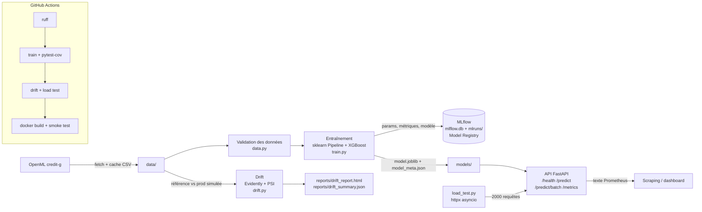

# Credit Scoring en production : pipeline MLOps

Projet portfolio de **Rody Brayan DAMA** (alternant AI / Data Engineer, BNP Paribas Cardif).

Objectif : montrer le chemin complet d'un modèle de risque de crédit, du jeu de données à un
service HTTP monitoré, avec des mesures **réellement obtenues** (aucun chiffre saisi à la main :
tout le tableau de résultats provient de `reports/metrics.json`, généré par la pipeline).

## Contexte métier

Un organisme de crédit doit décider, pour chaque demande, d'**accorder ou refuser** le prêt.
Le modèle estime la **probabilité de défaut (PD)** à partir de 20 variables du dossier
(statut du compte courant, durée, montant, historique, épargne, emploi…).

- **Données** : *German Credit* (OpenML `credit-g`, 1 000 dossiers, 30 % de mauvais payeurs).
- **Métriques de discrimination** : AUC et **Gini = 2·AUC − 1**, l'indicateur usuel des équipes
  risque.
- **Seuil de décision piloté par le coût** : la matrice de coûts officielle du jeu fixe
  « accorder à un mauvais payeur » = 5 et « refuser un bon payeur » = 1. Le seuil bayésien
  optimal sur la PD est donc `1 / (1 + 5) ≈ 0,167` : on refuse dès que PD ≥ 16,7 %.
  Ce choix est volontairement conservateur (taux de refus élevé) : il découle du coût, pas d'un
  réglage arbitraire.
- **Monitoring** : en production, la population change (inflation des montants, nouveaux
  canaux de distribution…). On détecte le **drift** des variables (Evidently) et du score
  (PSI, l'indicateur de stabilité classique en risque de crédit).

## Architecture



| Composant | Fichier | Rôle |
|---|---|---|
| Données | `src/credit_scoring/data.py` | Téléchargement OpenML, cache, contrôles qualité, split stratifié |
| Entraînement | `src/credit_scoring/train.py` | Pipeline one-hot + XGBoost, CV 5 folds, tracking + registry MLflow |
| Contrat d'API | `src/credit_scoring/schemas.py` | Schémas pydantic v2 stricts (modalités `Literal`, bornes, `extra="forbid"`) |
| Inférence rapide | `src/credit_scoring/scoring.py` | Pré-traitement « compilé » en numpy, équivalence testée avec le pipeline |
| Service | `src/credit_scoring/api.py` | FastAPI, middleware ASGI de métriques, format Prometheus |
| Drift | `src/credit_scoring/drift.py` | Evidently `DataDriftPreset` + PSI par variable et sur le score |
| Charge | `scripts/load_test.py` | Lance uvicorn, 2 000 requêtes concurrentes, p50/p95/débit |
| Agrégation | `scripts/collect_metrics.py` | Construit `reports/metrics.json` à partir des sorties réelles |

## Résultats

Valeurs copiées depuis [`reports/metrics.json`](reports/metrics.json) (exécution locale :
Windows 11, Ryzen 7 5700U, Python 3.12, uvicorn 1 worker).

| Domaine | Indicateur | Valeur |
|---|---|---|
| Modèle (test, 200 dossiers) | AUC | **0,7564** |
| | Gini | **0,5129** |
| | AUC validation croisée 5 folds (train) | 0,7939 |
| | Coût métier moyen / dossier (seuil 0,167) | 0,52 (vs 1,50 en acceptant tout) |
| API, charge (2 000 req., concurrence 20) | p50 | 124,6 ms |
| | p95 | 1 239,01 ms |
| | Débit | 62,1 req/s |
| | Erreurs | 0 |
| API, latence unitaire (2 000 req., concurrence 1) | p50 / p95 | 18,6 ms / 36,5 ms |
| Qualité | Tests pytest | 63 (0 échec) |
| | Couverture (lignes + branches) | 97,1 % |
| Drift (prod simulée vs référence) | Colonnes en drift | 5 / 20 (share = 0,25) |
| | Drift global Evidently (seuil share ≥ 0,5) | non |
| | PSI du score | 0,3932 (> 0,25 → drift) |

**Lecture honnête des résultats**

- L'écart AUC CV (0,79) / test (0,76) reflète la petite taille du jeu (200 dossiers de test,
  écart-type CV ≈ 0,06) ; pas de sur-optimisation des hyperparamètres sur le test.
- Les chiffres de charge sont ceux d'un **laptop Windows avec antivirus inspectant le trafic
  local**, client et serveur sur la même machine. Ils varient fortement d'une exécution à
  l'autre : deux runs consécutifs à concurrence 20 ont donné 10,2 puis 62,1 req/s. Le p95 élevé
  à concurrence 20 est surtout de la **file d'attente** sur un seul worker (loi de Little :
  20 requêtes en vol / 62 req/s ≈ 320 ms de latence moyenne). Le temps passé dans
  l'application elle-même (mesuré par le middleware) est d'environ 8 ms par requête en séquentiel.
- Le scénario de drift simule 4 changements (montants +40 %, durée +6 mois, clientèle plus jeune,
  35 % de dossiers basculés en compte débiteur). Evidently les détecte tous, plus
  `credit_history` (écart déjà présent entre train et test). Le seuil global d'Evidently (50 % des
  colonnes) n'est pas franchi, mais le **PSI du score** (0,39) signale clairement que la
  population scorée a changé : c'est l'alerte qu'une équipe risque exploiterait.

### Optimisations mesurées

Scoring d'un dossier, en processus (500 appels) : pipeline sklearn complet **17,6 ms** →
`FastScorer` (pré-traitement numpy, mêmes probabilités à 1e-6 près) **2,6 ms**.

| Étape (API, `FastScorer` déjà actif) | p50 séquentiel |
|---|---|
| Endpoints synchrones (threadpool) + `@app.middleware("http")` | ~41 ms |
| Endpoints `async` (calcul ~3 ms, pas de saut de thread) | ~21 ms |
| + middleware ASGI pur | ~19 ms |

(mesures de mise au point sur 300 requêtes, hors `metrics.json`, même machine bruitée.)

## Lancer le projet

```bash
python -m venv .venv
# Windows : .venv\Scripts\activate   |   Linux/macOS : source .venv/bin/activate
pip install -r requirements-dev.txt

export PYTHONPATH=src            # PowerShell : $env:PYTHONPATH="src"

python -m credit_scoring.train   # données OpenML -> MLflow + models/
pytest --cov --cov-report=term --cov-report=json:reports/coverage.json --junitxml=reports/junit.xml
python -m credit_scoring.drift   # reports/drift_report.html + drift_summary.json
python scripts/load_test.py --requests 2000 --concurrency 20
python scripts/load_test.py --requests 2000 --concurrency 1 --output reports/load_test_sequential.json
python scripts/collect_metrics.py   # reports/metrics.json
```

Servir l'API et l'interroger :

```bash
uvicorn credit_scoring.api:app --port 8000
curl localhost:8000/health
curl -X POST localhost:8000/predict -H "Content-Type: application/json" -d '{
  "checking_status": "<0", "duration": 24, "credit_history": "existing paid",
  "purpose": "radio/tv", "credit_amount": 3500, "savings_status": "<100",
  "employment": "1<=X<4", "installment_commitment": 3, "personal_status": "male single",
  "other_parties": "none", "residence_since": 2, "property_magnitude": "car", "age": 35,
  "other_payment_plans": "none", "housing": "own", "existing_credits": 1, "job": "skilled",
  "num_dependents": 1, "own_telephone": "none", "foreign_worker": "yes"}'
# -> {"probability_default": ..., "decision": "approve|reject", "threshold": 0.1667,
#     "model_version": "credit-scoring-xgb:1"}
curl localhost:8000/metrics      # compteurs Prometheus
```

Documentation interactive : <http://localhost:8000/docs>. Interface MLflow :
`mlflow ui --backend-store-uri sqlite:///mlflow.db`.

### Docker

```bash
docker build -t credit-scoring-api .
docker run -p 8000:8000 credit-scoring-api
```

Image multi-étapes `python:3.12-slim`, utilisateur non-root, `HEALTHCHECK`, dépendances
d'inférence seulement (`requirements-api.txt` : ni MLflow ni Evidently).
**Docker n'est pas installé sur la machine de développement : l'image n'a pas été construite
localement.** Elle est construite et testée (smoke test `/health`, `/predict`, utilisateur
non-root) par le job `docker` de la CI GitHub Actions.

## Choix techniques et limites

- **MLflow 3.x** : le backend « fichiers seuls » (`./mlruns`) est en maintenance et lève une
  erreur par défaut. Le projet suit la recommandation officielle : métadonnées et Model Registry
  dans `mlflow.db` (SQLite), artefacts dans `mlruns/`. Le modèle est sérialisé via **skops**
  (pas de pickle arbitraire) avec les types XGBoost déclarés explicitement.
- **Evidently 0.7.23** n'est pas compatible avec pandas 3 (import d'une API interne supprimée) :
  pandas est épinglé en 2.3.3.
- Le schéma d'API n'accepte que les modalités présentes dans les données : `vacation` et
  `female single`, documentées dans le jeu d'origine mais absentes des 1 000 lignes, sont
  refusées (422) plutôt que scorées silencieusement. Un test vérifie l'alignement schéma / données.
- Les métriques `/metrics` sont en mémoire par processus (pas de `prometheus_client`
  multiprocess) : suffisant pour une démo, à remplacer en multi-workers.
- Le lot de « production » est simulé : il sert à démontrer la chaîne de détection, pas à
  mesurer un drift réel.
- German Credit contient des variables sensibles (`personal_status` mêle sexe et statut
  marital, `foreign_worker`) : un modèle réel devrait passer une revue d'équité / conformité
  avant usage.

## Compétences démontrées

- **ML appliqué au risque** : pipeline sklearn, XGBoost, validation croisée stratifiée, AUC/Gini,
  Brier, seuil dérivé d'une matrice de coûts.
- **MLOps** : tracking d'expériences et Model Registry MLflow, versionnement du modèle exposé
  par l'API, artefacts reproductibles.
- **Ingénierie logicielle** : FastAPI, pydantic v2, middleware ASGI, tests pytest (API, modèle,
  données, drift) à 97 % de couverture, ruff.
- **Performance** : test de charge asynchrone, profilage et optimisation du chemin d'inférence
  avec test d'équivalence.
- **Monitoring** : Evidently, PSI, export Prometheus.
- **Industrialisation** : Dockerfile multi-étapes non-root, CI GitHub Actions
  (lint → tests → entraînement → drift → charge → build + smoke test Docker).
